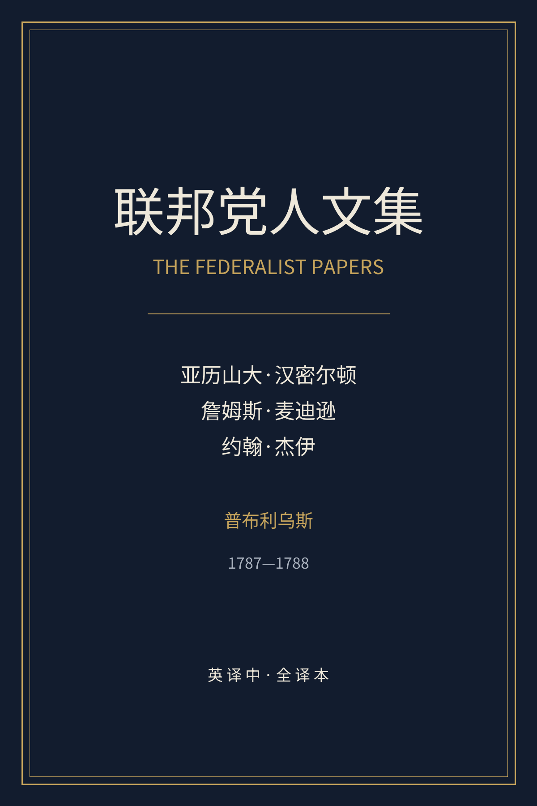
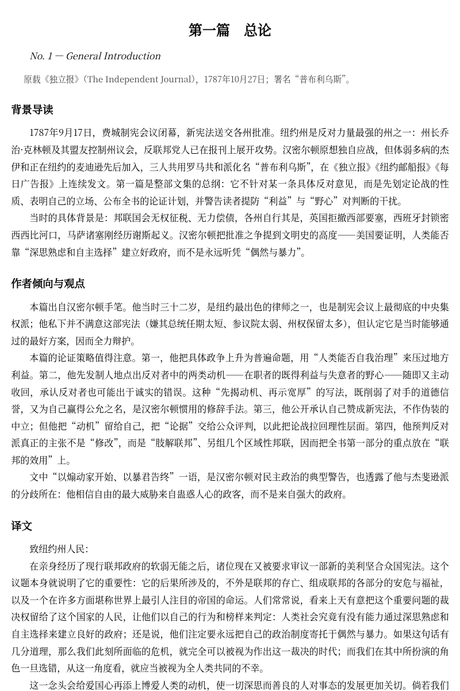
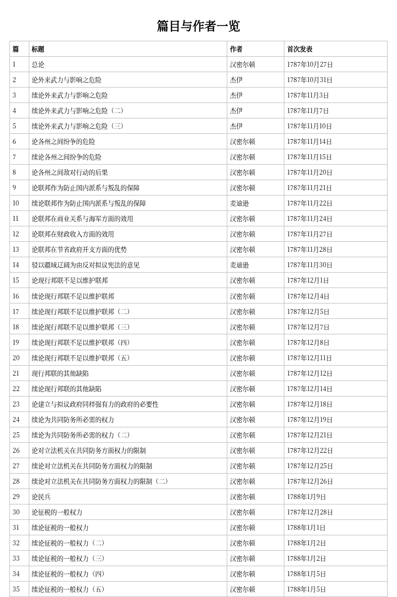

# 《联邦党人文集》全译本

The Federalist Papers, translated into Chinese, with a background introduction and an author-analysis note for every essay.

## 项目状态

已完成八十五篇全译。

- 底本：Project Gutenberg eBook #18，已拆为 `src/essays/01.md` … `85.md`。
- 译文：`zh/01.md` … `zh/85.md`，每篇含“背景导读”“作者倾向与观点”“译文”“注释”。
- 前言与导论：`zh/00-front.md`、`zh/00-intro.md`。
- 附录：`notes/authors.md`（三位作者）、`notes/context.md`（批准之争大事年表）、`glossary.md`（统一译名表）、`notes/textual.md`（底本与校勘）。
- 目录与元数据：`notes/index.json`（篇号、中英文标题、日期、报纸、作者）。
- 正文约 26.0 万汉字；导读与作者分析约 5.5 万汉字；注释约 1.0 万汉字。

## 预览







## 体例

见 `BRIEF.md`。要点：

1. 全文逐段直译，不删节、不概括。
2. 长句按中文意群拆分，保留原文逻辑关系。
3. 专名与术语严格照 `glossary.md`。
4. 每篇前有 300—500 字的背景导读与作者分析。
5. 古典引文、历史典故、法律术语出注；常识不注。

## 构建

依赖：`pandoc`、`python3`、Pillow（生成封面）。

```bash
cd federalist
python3 -I tools/make_cover.py      # 生成 build/cover.png
bash build.sh                        # 合并、生成 EPUB、HTML 与 DOCX
```

产物：

- `dist/联邦党人文集.epub`
- `dist/联邦党人文集.html`
- `dist/联邦党人文集.docx`

电子书文件可在本仓库的 **Releases** 页面下载，不纳入 Git 历史。

## 质检

```bash
python3 -I tools/qa.py src/essays zh        # 逐篇字数、段数、字词比
python3 -I tools/check_meta.py zh notes/index.json   # 标题、日期、脚注配对
```

`qa.py` 的判定标准：译文段落数与原文段落数之比在 0.6—2.0 之间，中文字数/英文词数在 1.05—2.8 之间。低于下限通常意味着漏译或概括，需要复核。

## 作者归属

- 汉密尔顿：第 1、6—9、11—13、15—17、21—36、59—61、65—85 篇。
- 麦迪逊：第 10、14、37—58、62—63 篇（49—58、62—63 旧题“汉密尔顿或麦迪逊”）。
- 杰伊：第 2—5、64 篇。
- 第 18—20 篇：旧题“汉密尔顿与麦迪逊”，今多认为汉密尔顿执笔、取材于麦迪逊札记。

## 版权

底本为公有领域文本；本译文为原创翻译，供阅读与研究使用。
